# Hive OS: Verifiable Agentic Software Delivery

> **Status:** Active development · **Case study:** one validated delivery pilot · **Role:** Product and AI engineer

Agentic coding becomes useful when it can do more than generate a patch. It needs a delivery path that makes every transition inspectable: what was requested, how the work was planned, which checks passed, what reviewers found, what was merged, and which exact commit reached production.

Hive OS is my work toward that system. I use a deliberately small lab application to test the delivery mechanics without exposing customer data or coupling the experiment to a production product.

## The problem

AI coding tools can produce code quickly, but speed is not the same as a trustworthy software-delivery process. A useful autonomous workflow must be able to:

- turn a ticket into a bounded implementation task;
- route work and difficult decisions to suitable models;
- require tests and independent review before merge;
- preserve a trace from the original request to the released commit; and
- confirm what is actually running after deployment.

The lab isolates the last part of that problem: moving a real change through checks, merge, release, deployment, and runtime verification.

## System boundary

```mermaid
flowchart LR
    subgraph O["Hive OS orchestration — in development, outside the lab repository"]
        T[Ticket intake] --> C[Classification and plan]
        C --> A[Agent implementation]
        A --> R[Multi-model critique]
    end

    subgraph V["Verified pilot delivery path"]
        S[Source change] --> Q[Node test suite]
        Q --> P[Pull request]
        P --> CI[PR and main CI]
        CI --> M[Merge]
        M --> B[Release branch]
        B --> D[Vercel deployment]
        D --> H[Commit-aware health check]
    end

    R -. delivery hand-off .-> S
```

The orchestration layer is the target architecture. Its private implementation and intermediate ticket, plan, routing, and critic artifacts are not part of this public pilot. The solid path in the diagram is the portion validated by repository and deployment evidence.

## What the pilot proved

The pilot change added an open-item summary to a tiny idea-list application. Its small scope is intentional: the experiment tests the delivery chain, not product complexity.

| Stage | Evidence |
| --- | --- |
| Change | A source change added the remaining-item count and singular/plural handling. |
| Automated checks | Three dependency-free Node.js tests passed, covering HTML escaping, completed-item rendering, and summary counts. |
| Pull request | One pull request carried the change and was merged. |
| Continuous integration | The pull-request run and post-merge `main` run both completed successfully on Node.js 22. |
| Release | The merged commit was promoted to the `release` branch and deployed to Vercel. |
| Runtime verification | The public health endpoint returned HTTP 200 and reported commit `b7d2e5276f18045af8e1e9d1216c0b250e1472b6`, matching the reviewed and deployed revision. |

The live deployment exposes a no-cache health endpoint at [hiveos-lab.fero-solutions.de/api/health](https://hiveos-lab.fero-solutions.de/api/health). Returning the Git commit alongside service health makes a deployment claim independently checkable at runtime.

## Engineering decisions

- **A disposable proving ground:** the lab contains no real customer data and can test release behavior without risking a production product.
- **Dependency-free tests:** the pilot uses Node's built-in test runner, keeping the validation surface small and deterministic.
- **Least-privilege CI:** the workflow only requests read access to repository contents.
- **Commit-aware health:** the deployment reports the exact Vercel Git revision and disables response caching, so a stale response cannot masquerade as a fresh release.
- **Separate orchestration and target application:** Hive OS can evolve independently of the repositories it operates on.

## What this does—and does not—demonstrate

This case study demonstrates one complete pilot path from source change through automated checks, pull request, merge, release-branch promotion, deployment, and live commit verification.

It does not yet provide public evidence for ticket classification, model routing, planning artifacts, two independent critic outputs, unattended merge authorization, branch-protection enforcement, recovery behavior, or operation at scale. Those are product goals that require their own auditable traces before they should be presented as proven capabilities.

## Next evidence milestone

The next useful artifact is a fully redacted delivery trace for one ticket. It should connect a stable ticket ID to the plan, model assignments, test results, critic verdicts, merge decision, deployment event, and live commit. Publishing that trace with synthetic data will make the orchestration layer assessable without revealing private repositories, prompts, or credentials.

---

**Verification note:** The technical claims above were checked against the private lab repository at commit `b7d2e5276f18045af8e1e9d1216c0b250e1472b6`, its pull-request and CI history, its Vercel deployment record, and the public runtime health response. The repository remains private while the broader system is under development.
