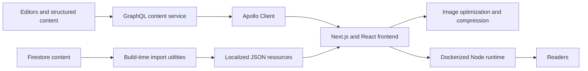

# IlluviHub: Migrating a Content Platform to a Headless, Containerized Stack

> **Status:** Historical project · **Role:** Frontend and migration engineer · **Outcome:** approximately 80% lower hosting costs, based on the project's operating experience

IlluviHub was a content-heavy community platform with news, guides, structured game data, and multilingual pages. I worked on moving its frontend from WordPress to a Next.js application backed by headless content services and a containerized deployment path.

## The problem

The existing setup made the application expensive to host and difficult to evolve as a product. The migration needed to support editorial content, dynamic routes, structured reference data, multiple languages, search-friendly pages, and media-heavy views while giving the engineering team more control over deployment.

My contribution focused on the frontend migration and the supporting data and deployment integration. The broader platform, editorial content, and media library were collaborative assets; this case study does not claim ownership of the entire product.

## Architecture

The reviewed implementation combined two content paths. Apollo Client connected server-rendered and client-rendered pages to a GraphQL CMS, while Firebase Admin utilities transformed structured Firestore data into locale-specific JSON during the build process. The frontend then composed both sources into statically generated and dynamic Next.js pages.

## What I built

- A Next.js 13 and React 18 frontend with reusable layouts and components for news, guides, team pages, buildings, and a structured item compendium.
- Apollo Client integration for GraphQL-backed content, including server-side rendering support and cache hydration.
- Dynamic routes for articles, guides, pagination, and catch-all CMS pages.
- Language-specific content resources across English, German, French, Italian, and Russian locale directories.
- Firebase import and export utilities that bridged structured content and build-time JSON resources.
- SEO metadata, sitemap generation, image optimization, response compression, and consent-aware analytics loading.
- A Docker-based Node.js build and runtime path for self-hosted deployment.

## Key decisions and trade-offs

### Separate editorial and structured data

Editorial pages and frequently changing articles fit the GraphQL CMS, while larger structured datasets could be generated at build time. This reduced runtime coupling, but it also created two content paths that had to remain consistent.

### Generate locale resources before the build

The export command refreshed localized data before building and statically exporting the site. That made content available as ordinary application assets, trading real-time updates for simpler and cheaper delivery.

### Move deployment into a container

The Dockerized runtime made the application portable to self-managed infrastructure and reduced dependence on the previous hosting setup. According to the project's operating experience, the migration reduced hosting costs by approximately 80%. The source snapshot does not contain the historical billing baseline, so this is an operational result rather than an independently reproduced benchmark.

## Result

The migration produced a modern frontend that could serve editorial pages and structured reference content from a single user experience. It also established a more portable deployment model and materially lowered reported hosting costs while keeping the product's multilingual and media-heavy scope.

The strongest engineering value of the project was the migration itself: translating an established content product into clearer frontend, data-integration, and deployment boundaries while keeping the visible experience intact.

## Evidence and limits

The architecture and feature descriptions above were checked against a private source snapshot containing the Next.js application, GraphQL integration, localization resources, Firebase data utilities, and Docker configuration.

No retained benchmark proves application-speed improvements, and the repository has no project-specific automated test or CI workflow in the reviewed state. The approximately 80% hosting-cost reduction is therefore presented as a reported project outcome, not a laboratory measurement.

The original repository remains private because its history contains legacy service credentials and third-party media whose redistribution rights have not been established. No credential values, private endpoints, customer data, or third-party assets are included here. Any future public code sample should start from a clean history, use synthetic content, load credentials through secret management, add tests and CI, and include only assets with documented provenance.

---

**Verification note:** This case study documents my frontend and migration contribution. It deliberately avoids presenting the wider team's work or the full platform as my individual implementation.
